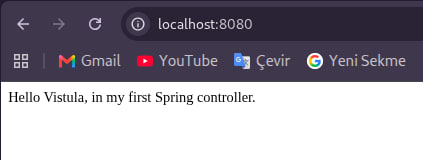
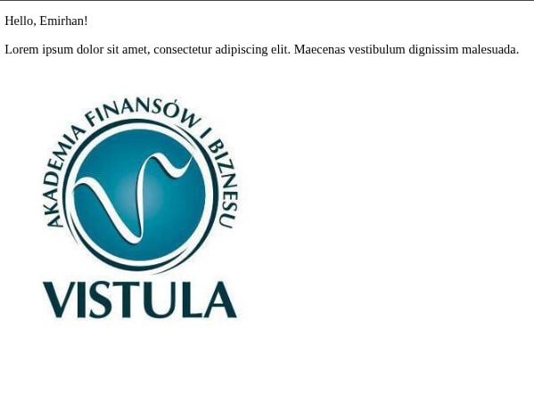

Project No. 1: Spring Boot MVC & Thymeleaf Web Application

This repository contains the first Spring Framework project developed for the Packages and Interfaces / Spring Framework course at Vistula University. The project demonstrates the fundamentals of building a web application using the Spring MVC architectural pattern and the Thymeleaf server-side template engine.

🛠️ Technologies & Tools Used

Java 17 – Core programming language

Spring Boot 3 – Application framework and embedded Tomcat server

Spring Web (MVC) – Handling HTTP requests and routing via @Controller

Thymeleaf – Server-side HTML template engine for rendering dynamic views

Maven – Dependency management and project build tool

Visual Studio Code – Integrated Development Environment

Git & GitHub – Version control and repository hosting

✨ Features & Endpoints

Root Endpoint (GET /)

Handled by HelloController.hello() with @ResponseBody.

Returns a plain text greeting message ("Hello Vistula, in my first Spring controller.") directly to the client response.

Dynamic Greeting Page (GET /greeting)

Handled by HelloController.greeting().

Accepts an optional query parameter name (defaults to "World" if not provided).

Passes the parameter to the Thymeleaf model (model.addAttribute) and renders greeting.html.

Static Resource Serving

Serves static image assets (vistula.png) from src/main/resources/static/images/ using Thymeleaf's @{/images/vistula.png} syntax.

📁 Project Structure

src/main/
├── java/pl/edu/vistula/firstprojectjavaspring/
│   ├── FirstProjectJavaSpringApplication.java   # Main entry point
│   └── controller/
│       └── HelloController.java                 # MVC Controller handling routes
└── resources/
    ├── application.properties                   # Server configuration (Port 8080)
    ├── static/images/
    │   └── vistula.png                          # Static university logo
    └── templates/
        └── greeting.html                        # Thymeleaf HTML view

🚀 How to Run Locally

Clone the repository:

git clone https://github.com/EmirHAN60/java-project-1.git
cd java-project-1

Run the application using Maven Wrapper:

./mvnw spring-boot:run

Access the endpoints in your browser:

Root text endpoint: http://localhost:8080/

Dynamic greeting page: http://localhost:8080/greeting?name=Emirhan

## 📸 Application Demonstration

### 1. Root Endpoint (`GET /`)

### 2. Dynamic Greeting & Static Logo (`GET /greeting?name=Emirhan`)

